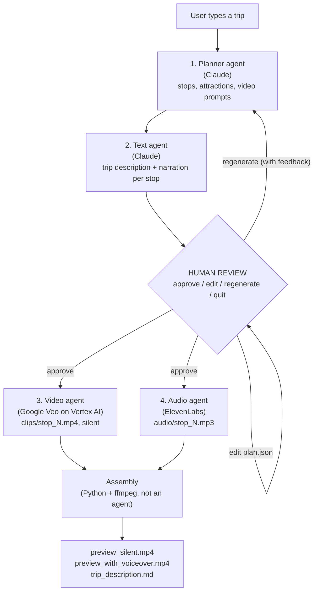

# AI Travel Route Preview

**CSCI 4083 Final Project:** a multi-agent AI system that turns a trip idea into a
drone-style video preview, a separate voiceover, and a written trip description.

Type a trip, for example `"Lake Tahoe"` or `"Mobile, AL -> Biloxi, MS -> New Orleans, LA"`, and get:

| Output | What it is |
|---|---|
| `preview_silent.mp4` | **Official output.** Silent drone-style video, one clip per stop. Has no audio track. |
| `audio/stop_N.mp3` | AI voiceover narrating each stop, generated separately from the video |
| `trip_description.md` | Written description of the trip |
| `preview_with_voiceover.mp4` | Demo-only version with the voiceover laid over the video |

Trips are limited to **5 stops** to keep video costs predictable.

---

## How it works

Four AI agents, one human checkpoint, and a final assembly step. The orchestration is
plain Python we wrote ourselves (`orchestrator.py`). We don't use any agent framework.



**How the agents share data:** all agents work on one shared `TripPlan` object (see `models.py`).
Each agent fills in its own fields and hands the plan back to the orchestrator. Agents
never call each other.

**Why the human review comes before video:** video generation is the slowest and most
expensive step. A person checks the plan (stops, prompts, narration) *before* any money
is spent on video or voice.

**How clips and narration line up:** each narration is capped at about 20 words
(roughly 8 seconds, the length of one clip). If a narration still runs longer than its
clip, assembly slows down or freezes the clip so the two finish together.

### Agents and providers

| # | Agent | Provider | Input → Output |
|---|---|---|---|
| 1 | Planner | Anthropic Claude | Trip text → up to 5 stops, attractions, a video prompt per stop |
| 2 | Text | Anthropic Claude | Plan → trip description + narration per stop (≤ ~20 words) |
| 3 | Video | Google Veo 3.1 Lite (Vertex AI, 720p) | Video prompt → one silent clip per stop |
| 4 | Audio | ElevenLabs | Narration → one mp3 per stop |
| – | Assembly (not an agent) | ffmpeg | Clips + mp3s → final files |

All provider calls use each company's official Python SDK.

---

## Professor's requirements

| # | Requirement | How we meet it |
|---|---|---|
| 1 | At least 4 agents | Planner, Text, Video, Audio |
| 2 | Custom Python orchestration, no agent frameworks | `orchestrator.py` is plain Python function calls. No LangChain, LangGraph, CrewAI, AutoGen, or OpenAI Agents SDK. |
| 3 | At least one human-in-the-loop point | `human_review.py`: a person approves, edits, or regenerates the plan before any video is made |
| 4 | Video, audio, and text agents use different providers | Video = Google, Audio = ElevenLabs, Text = Anthropic |
| 5 | Video preview has no audio; voiceover generated separately | Assembly removes any audio track with ffmpeg; a test uses `ffprobe` to confirm `preview_silent.mp4` has no audio stream |
| 6 | Every team member understands the code | Beginner-friendly comments explaining *why*; each person owns and can explain their files |

---

## Team

| Person | Builds |
|---|---|
| Palden | `config.py`, `models.py`, orchestrator, human review, assembly, mock media, `main.py`, shared tests, planner agent, text agent, repo |
| Dipesh | Real Veo call in `agents/video_agent.py` |
| Ankit | Real ElevenLabs call in `agents/audio_agent.py` |
| Everyone | Report and slides (Google Docs; final PDFs go in `docs/`) |

---

## For Dipesh and Ankit: how to add your agent

Your agent file already exists and **already works in mock mode**. The loop over
stops, skipping files that already exist, safe saving, and file naming are all done.
You only fill in **one function** that makes **one file**.

| | Dipesh (video) | Ankit (audio) |
|---|---|---|
| File | `agents/video_agent.py` | `agents/audio_agent.py` |
| Function to fill in | `generate_clip(prompt, out_path)` | `generate_narration_audio(text, out_path)` |
| What it receives | `prompt`: one stop's `video_prompt` (str)<br>`out_path`: where to save (`Path`) | `text`: one stop's `narration`, ≤ ~20 words (str)<br>`out_path`: where to save (`Path`) |
| What it must do | Save a playable `.mp4` at `out_path` | Save a playable `.mp3` at `out_path` |
| What it returns | Nothing (`None`) | Nothing (`None`) |
| On failure | Raise an exception with a clear message | Raise an exception with a clear message |
| SDK | `google-genai` (Vertex AI mode) | `elevenlabs` |
| Settings to use | `config.get_google_project()`, `config.GOOGLE_CLOUD_LOCATION`, `config.VEO_MODEL`, `config.VEO_RESOLUTION`, `config.VEO_CLIP_SECONDS` | `config.get_api_key("ELEVENLABS_API_KEY")`; add `ELEVENLABS_VOICE_ID` and `ELEVENLABS_MODEL` to `config.py` and `.env.example` |

The `TODO` comment inside each function lists the suggested steps.

**Rules:**
- Don't rename files or change `out_path`. The loop saves to a temporary `.partial`
  file and renames it only when your function finishes without an error. That's how
  a crashed run never leaves a half-made file that gets skipped next time.
- Don't change `make_clips()` / `make_voiceovers()` or the mock-mode code. If you think
  they need a change, ask Palden.
- Add your SDK to `requirements.txt`.
- **Dipesh, first task:** make one real Veo test call and find out whether Vertex AI
  needs a Cloud Storage bucket for the output. If it does, add a `GCS_OUTPUT_BUCKET`
  setting.

**How to test:**
1. Mock tests (free): `pytest tests/test_video_agent.py` or `pytest tests/test_audio_agent.py` *(coming soon)*
2. One real run with a **1-stop trip** to keep the cost low:
   `python main.py "Lake Tahoe"` *(coming soon)*
3. Open the file in `output/<run>/clips/` or `output/<run>/audio/` and check it plays.

---

## Project structure

```
main.py               command-line entry point                    (coming soon)
orchestrator.py       runs every step in order, writes the run log (coming soon)
human_review.py       approve / edit / regenerate / quit          (coming soon)
assembly.py           ffmpeg: builds the final files              (coming soon)
mock_media.py         fake clips/audio for mock mode
models.py             TripPlan + Stop: the shared data format
config.py             settings, .env loading, run folders, file names
agents/
  planner_agent.py    Claude                                      (coming soon)
  text_agent.py       Claude                                      (coming soon)
  video_agent.py      Veo: mock mode works, real call TODO (Dipesh)
  audio_agent.py      ElevenLabs: mock mode works, real call TODO (Ankit)
tests/                pytest tests, all run in mock mode          (coming soon)
docs/                 final report and slides PDFs                (at the end)
output/               one folder per run (not committed)
```

---

## Setup

### 1. Python 3.12
```bash
python3.12 -m venv .venv
source .venv/bin/activate          # Windows: .venv\Scripts\activate
pip install -r requirements.txt    # (coming soon)
```

### 2. ffmpeg (needed even in mock mode)
```bash
brew install ffmpeg                # macOS
sudo apt install ffmpeg            # Ubuntu/Debian
winget install Gyan.FFmpeg         # Windows
```
Check it worked: `ffmpeg -version` and `ffprobe -version`

### 3. Settings file
```bash
cp .env.example .env
```
Then fill in `.env`. **Never commit `.env`.** It's already in `.gitignore`.
In mock mode you can leave the keys blank.

### 4. Google Cloud / Vertex AI (only for real video generation)
The video agent uses Vertex AI and our Google Cloud free-trial credits. It does **not**
use a Gemini API key.
1. Install the [gcloud CLI](https://cloud.google.com/sdk/docs/install)
2. Log in once on your machine:
   ```bash
   gcloud auth application-default login
   gcloud config set project YOUR_PROJECT_ID
   gcloud services enable aiplatform.googleapis.com
   ```
3. Put `YOUR_PROJECT_ID` in `.env` as `GOOGLE_CLOUD_PROJECT`

---

## Running

### Mock mode (free, no API calls) *(coming soon)*
```bash
python main.py "Mobile, AL -> Biloxi, MS -> New Orleans, LA" --mock
```
Mock mode runs the whole pipeline, including the human review step, with fake text,
colored placeholder clips, and beep-tone audio. Use it for development and testing.

### Real mode *(coming soon)*
```bash
python main.py "Lake Tahoe"
```

Each run creates `output/<date_time>/` containing `plan.json`, `run_log.csv`
(agent, time taken, success/fail), `clips/`, `audio/`, and the final files.
**Reruns skip any clip or mp3 that already exists**, so you never pay for the same file twice.

### Tests *(coming soon)*
```bash
pytest
```

---

## Rules for contributors
- Don't commit API keys or `.env`.
- In your code, read settings as `config.MOCK_MODE`, not `from config import MOCK_MODE`
  (the second form won't see `--mock`).
- Every agent must support mock mode.
- Keep code simple and commented. You must be able to explain every line you commit.

---

## Status

- [x] Shared data format (`models.py`)
- [x] Settings and config (`config.py`, `.env.example`)
- [x] Mock media helpers (`mock_media.py`)
- [x] Video agent: mock mode (real Veo call: Dipesh)
- [x] Audio agent: mock mode (real ElevenLabs call: Ankit)
- [ ] Planner agent
- [ ] Text agent
- [ ] Human review
- [ ] Assembly
- [ ] `main.py` + orchestrator
- [ ] Tests
- [ ] Real Veo call (Dipesh)
- [ ] Real ElevenLabs call (Ankit)
- [ ] Report + slides
