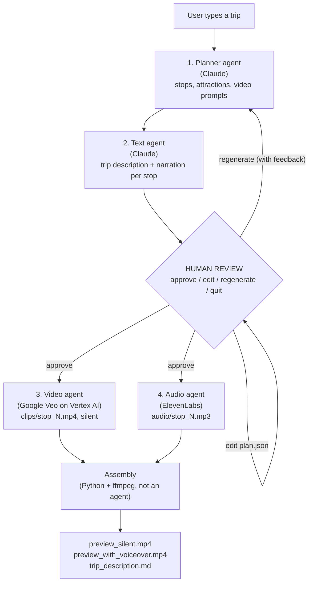

# AI Travel Route Preview

**CSCI 4083 Final Project:** a multi-agent AI system that turns a trip idea into a
drone-style video preview, a separate voiceover, and a written trip description.

Type a trip, for example `"Lake Tahoe"` or `"Mobile, AL -> Biloxi, MS -> New Orleans, LA"`, and get:

| Output | What it is |
|---|---|
| `preview_silent.mp4` | **Official output.** Silent drone-style video, one clip per stop. Has no audio track. |
| `audio/stop_N.mp3` | AI voiceover narrating each stop, generated separately from the video |
| `trip_description.md` | Written description of the trip |
| `preview_with_voiceover.mp4` | Demo-only version with the voiceover laid over the video |

Trips are limited to **5 stops** to keep video costs predictable.

---

## How it works

Four AI agents, one human checkpoint, and a final assembly step. The orchestration is
plain Python we wrote ourselves (`orchestrator.py`). We don't use any agent framework.



**How the agents share data:** all agents work on one shared `TripPlan` object (see `models.py`).
Each agent fills in its own fields and hands the plan back to the orchestrator. Agents
never call each other.

**Why the human review comes before video:** video generation is the slowest and most
expensive step. A person checks the plan (stops, prompts, narration) *before* any money
is spent on video or voice.

**How clips and narration line up:** each narration is capped at about 20 words
(roughly 8 seconds, the length of one clip). If a narration still runs longer than its
clip, assembly slows down or freezes the clip so the two finish together.

### Agents and providers

| # | Agent | Provider | Input → Output |
|---|---|---|---|
| 1 | Planner | Anthropic Claude | Trip text → up to 5 stops, attractions, a video prompt per stop |
| 2 | Text | Anthropic Claude | Plan → trip description + narration per stop (≤ ~20 words) |
| 3 | Video | Google Veo 3.1 Lite (Vertex AI, 720p) | Video prompt → one silent clip per stop |
| 4 | Audio | ElevenLabs | Narration → one mp3 per stop |
| – | Assembly (not an agent) | ffmpeg | Clips + mp3s → final files |

All provider calls use each company's official Python SDK.

---

## Professor's requirements

| # | Requirement | How we meet it |
|---|---|---|
| 1 | At least 4 agents | Planner, Text, Video, Audio |
| 2 | Custom Python orchestration, no agent frameworks | `orchestrator.py` is plain Python function calls. No LangChain, LangGraph, CrewAI, AutoGen, or OpenAI Agents SDK. |
| 3 | At least one human-in-the-loop point | `human_review.py`: a person approves, edits, or regenerates the plan before any video is made |
| 4 | Video, audio, and text agents use different providers | Video = Google, Audio = ElevenLabs, Text = Anthropic |
| 5 | Video preview has no audio; voiceover generated separately | Assembly removes any audio track with ffmpeg; a test uses `ffprobe` to confirm `preview_silent.mp4` has no audio stream |
| 6 | Every team member understands the code | Beginner-friendly comments explaining *why*; each person owns and can explain their files |

---

## Team

| Person | Builds |
|---|---|
| Palden | `config.py`, `models.py`, orchestrator, human review, assembly, mock media, `main.py`, shared tests, planner agent, text agent, repo |
| Dipesh | The entire video agent, `agents/video_agent.py`, from scratch: mock mode, the loop over stops, the Veo call, file handling, and its tests |
| Anjit | The entire audio agent, `agents/audio_agent.py`, from scratch: mock mode, the loop over stops, the ElevenLabs call, file handling, and its tests |
| Everyone | Report and slides (Google Docs; final PDFs go in `docs/`) |

---

## For Dipesh and Anjit: how to add your agent

**Status:** the audio agent is implemented with mock generation, an ElevenLabs
code path, file reuse, temporary-file cleanup, and offline tests. Live ElevenLabs
generation was verified on November 26, 2026 with a replacement API key: the MP3
decoded successfully, and Anjit confirmed it sounded good. The video agent
is still empty. This section is the contract your agent must meet so it plugs into
the rest of the pipeline.

### How your agent fits into the pipeline
1. The planner and text agents fill in a `TripPlan` (see `models.py`).
2. A person approves the plan in the human review step.
3. The orchestrator calls **your** function once, with the approved plan and the
   run's output folder.
4. Your function makes one file per stop and returns the list of file paths.
5. Assembly finds your files by their standard names (see below) and builds the final videos.

Agents never call each other. You only read from the `TripPlan`; don't change it.

### The function the orchestrator will call (required names and signatures)

| | Dipesh (video) | Anjit (audio) |
|---|---|---|
| File | `agents/video_agent.py` | `agents/audio_agent.py` |
| Function | `make_clips(plan: TripPlan, run_dir: Path) -> list[Path]` | `make_voiceovers(plan: TripPlan, run_dir: Path) -> list[Path]` |
| What it reads from each stop | `stop.video_prompt` | `stop.narration` (≤ ~20 words) |
| What it makes per stop | One playable, **silent** `.mp4` | One playable `.mp3` |
| Where each file goes | `config.clip_path(run_dir, n)` → `clips/stop_N.mp4` | `config.audio_path(run_dir, n)` → `audio/stop_N.mp3` |
| What it returns | The list of clip paths, **in stop order** | The list of mp3 paths, **in stop order** |
| SDK (real mode) | `google-genai` (Vertex AI mode, not a Gemini API key) | `elevenlabs` |
| Settings to use | `config.get_google_project()`, `config.GOOGLE_CLOUD_LOCATION`, `config.VEO_MODEL`, `config.VEO_RESOLUTION`, `config.VEO_CLIP_SECONDS` | `config.get_api_key("ELEVENLABS_API_KEY")`; add `ELEVENLABS_VOICE_ID` and `ELEVENLABS_MODEL` to `config.py` and `.env.example` |

Stop numbers `n` start at **1** (Stop 1, Stop 2, ...), matching what the reviewer sees.

**Suggested (not required) structure:** a small helper that makes *one* file, which
`make_clips()` / `make_voiceovers()` call in a loop. For example
`generate_clip(prompt: str, out_path: Path) -> None` or
`generate_narration_audio(text: str, out_path: Path) -> None`. It saves the file at
`out_path` and raises an exception if anything fails.

### Mock-mode requirements
- Check `config.MOCK_MODE` **when your function runs** (write `config.MOCK_MODE`, not
  `from config import MOCK_MODE`).
- In mock mode: **no API calls, no API key needed, no cost.**
- Mock files must still be real, playable media files, because assembly joins them:
  - **Video:** a silent 1280x720 `.mp4`, `config.VEO_CLIP_SECONDS` long.
  - **Audio:** an `.mp3` roughly as long as the narration would take to say (about
    2.5 words per second). That way mock mode also tests assembly's slow-down/freeze logic.
- `mock_media.py` already has ffmpeg helpers you may use for this:
  `make_mock_clip(out_path, stop_number, seconds)` and `make_mock_audio(out_path, text)`.

### File-saving requirements
- **Skip files that already exist.** If `stop_N.mp4` / `stop_N.mp3` is already there
  from an earlier run, don't make it again (reruns must never pay twice). Still include
  its path in the returned list.
- **Never leave a broken file under the final name.** Save to a temporary file first
  (for example `stop_N.partial.mp4`) and rename it to the final name only after it's
  completely finished. Otherwise a crash halfway through leaves a half-made file that
  gets skipped forever on later runs.
- Use the `config` path helpers. Don't invent your own file names or folders.
- Print a short progress line per stop, e.g. `[video] Stop 2: making clip for Biloxi, MS...`.

### Error-handling requirements
- If anything fails (bad key, network error, the API refuses, a timeout), **raise an
  exception with a clear, plain-English message** saying what went wrong and how to fix it.
- Don't silently skip a stop, and don't return a path to a file that doesn't exist.
- **Video only:** Veo jobs are slow ("long-running"). Check on the job every ~10 seconds
  and give up with a clear error after a few minutes. Ask for no audio if the model has
  that option. Assembly also removes any audio track as a safety net.

### Other rules
- Add your SDK to `requirements.txt` with a pinned version.
- Write tests: `tests/test_video_agent.py` / `tests/test_audio_agent.py`, running in mock
  mode so they're free. At minimum, check one file per stop, correct names and order,
  skipping existing files, and no leftover `.partial` files.
- **Dipesh, first task:** make one real Veo test call and find out whether Vertex AI
  needs a Cloud Storage bucket for the output. If it does, add a `GCS_OUTPUT_BUCKET`
  setting.

**How to test:**
1. Mock tests (free): `pytest tests/test_video_agent.py` or `pytest tests/test_audio_agent.py`
   *(once you've written them)*
2. One real run with a **1-stop trip** to keep the cost low:
   `python main.py "Lake Tahoe"` *(coming soon)*
3. Open the file in `output/<run>/clips/` or `output/<run>/audio/` and check it plays.

---

## Project structure

```
main.py               command-line entry point                    (coming soon)
orchestrator.py       runs every step in order, writes the run log (coming soon)
human_review.py       approve / edit / regenerate / quit          (coming soon)
assembly.py           ffmpeg: builds the final files              (coming soon)
mock_media.py         fake clips/audio for mock mode
models.py             TripPlan + Stop: the shared data format
config.py             settings, .env loading, run folders, file names
agents/
  planner_agent.py    Claude                                      (coming soon)
  text_agent.py       Claude                                      (coming soon)
  video_agent.py      Veo: NOT IMPLEMENTED, empty file (Dipesh)
  audio_agent.py      ElevenLabs + mock audio (Anjit; offline and live audio verified)
tests/                pytest tests, all run in mock mode          (coming soon)
docs/                 final report and slides PDFs                (at the end)
output/               one folder per run (not committed)
```

---

## Setup

### 1. Python 3.12
```bash
python3.12 -m venv .venv
source .venv/bin/activate          # Windows: .venv\Scripts\activate
pip install -r requirements.txt    # (coming soon)
```

### 2. ffmpeg (needed even in mock mode)
```bash
brew install ffmpeg                # macOS
sudo apt install ffmpeg            # Ubuntu/Debian
winget install Gyan.FFmpeg         # Windows
```
Check it worked: `ffmpeg -version` and `ffprobe -version`

### 3. Settings file
```bash
cp .env.example .env
```
Then fill in `.env`. **Never commit `.env`.** It's already in `.gitignore`.
In mock mode you can leave the keys blank.

### 4. Google Cloud / Vertex AI (only for real video generation)
The video agent uses Vertex AI and our Google Cloud free-trial credits. It does **not**
use a Gemini API key.
1. Install the [gcloud CLI](https://cloud.google.com/sdk/docs/install)
2. Log in once on your machine:
   ```bash
   gcloud auth application-default login
   gcloud config set project YOUR_PROJECT_ID
   gcloud services enable aiplatform.googleapis.com
   ```
3. Put `YOUR_PROJECT_ID` in `.env` as `GOOGLE_CLOUD_PROJECT`

---

## Running

### Mock mode (free, no API calls) *(coming soon)*
```bash
python main.py "Mobile, AL -> Biloxi, MS -> New Orleans, LA" --mock
```
Mock mode runs the whole pipeline, including the human review step, with fake text,
colored placeholder clips, and beep-tone audio. Use it for development and testing.

### Real mode *(coming soon)*
```bash
python main.py "Lake Tahoe"
```

Each run creates `output/<date_time>/` containing `plan.json`, `run_log.csv`
(agent, time taken, success/fail), `clips/`, `audio/`, and the final files.
**Reruns skip any clip or mp3 that already exists**, so you never pay for the same file twice.

### Tests *(coming soon)*
```bash
pytest
```

---

## Rules for contributors
- Don't commit API keys or `.env`.
- In your code, read settings as `config.MOCK_MODE`, not `from config import MOCK_MODE`
  (the second form won't see `--mock`).
- Every agent must support mock mode.
- Keep code simple and commented. You must be able to explain every line you commit.

---

## Status

- [x] Shared data format (`models.py`)
- [x] Settings and config (`config.py`, `.env.example`)
- [x] Mock media helpers (`mock_media.py`)
- [ ] Video agent: not implemented (Dipesh, entire agent including mock mode)
- [x] Audio agent implementation and offline tests (Anjit)
- [x] Live audio verification with a replacement ElevenLabs key and listening check (November 26, 2026)
- [ ] Planner agent
- [ ] Text agent
- [ ] Human review
- [ ] Assembly
- [ ] `main.py` + orchestrator
- [ ] Tests
- [ ] Report + slides

### Audio-only verification

With the project virtual environment active and ffmpeg on PATH, run:

```bash
python -m pytest tests/test_audio_agent.py tests/test_audio_failures.py -q
```

These tests are offline. They check actual mock MP3 decoding, stop order, reuse,
missing-key handling, interrupted and empty streams, and temporary-file cleanup.
The failure-only tests also run without pytest or ffmpeg:

```bash
python3 -m unittest discover -s tests -p test_audio_failures.py
```

Mock audio is a beep, not spoken narration. On November 26, 2026, all 9 offline
audio tests passed in a temporary Python 3.9 environment with pytest 8.4.2 and
ffmpeg. A separate live ElevenLabs request using the replacement key generated
a valid MP3; decoding succeeded and Anjit confirmed the recording sounded good.
The project's Python 3.12 dependency environment has not yet been verified.
Keep API keys in the ignored local `.env` and generated recordings in `output/`;
neither belongs in a commit.
